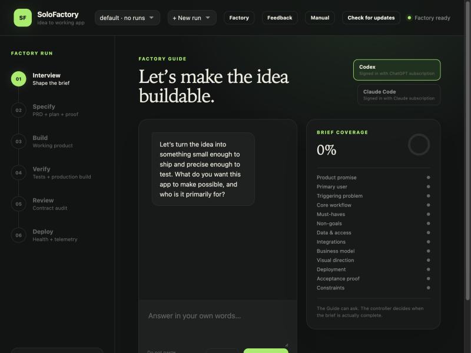
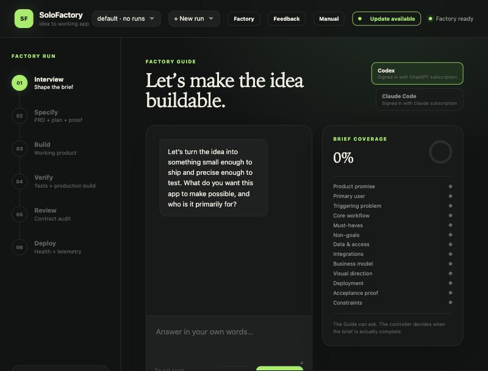
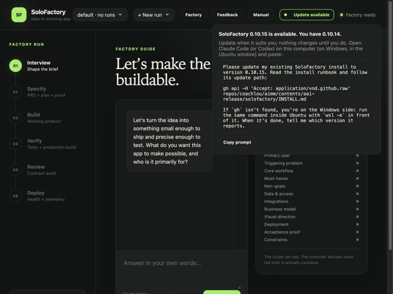
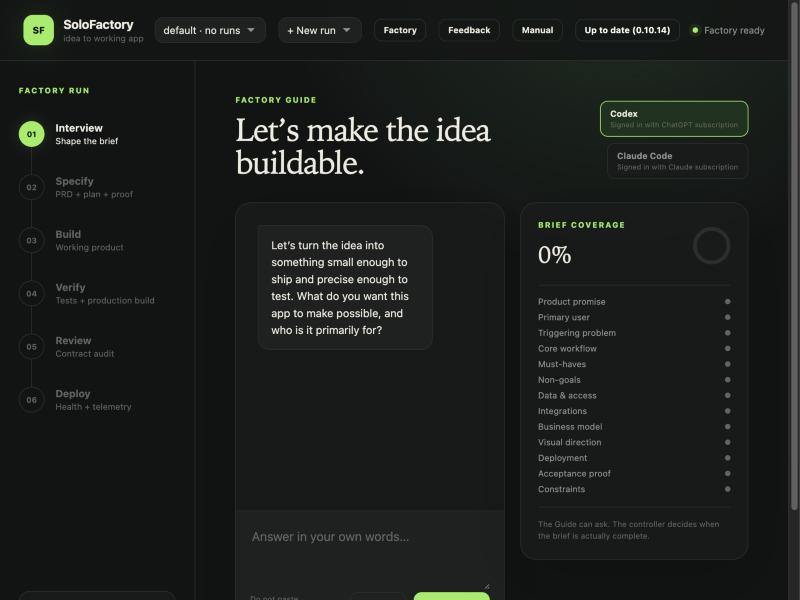

# The update notice

From 0.10.14 on, SoloFactory tells you itself when a newer version exists. You no longer need to wait for an email.

## Where it lives

There's a button in the top bar, next to *Manual*. Most of the time it just says *Check for updates* and stays out of your way.

## When a new version is out

The button turns into a green *Update available* pill. It stays there, in the corner, so you won't miss it. Nothing covers your work, nothing pops up over the Guide or the run page, and a run in progress keeps going.

Click the pill and a small panel opens under it. It shows:

- which version is out and which one you have;
- a reminder that nothing changes until you update;
- the exact prompt to paste into Claude Code (or Codex), with a **Copy prompt** button.

Click the pill again, or anywhere else, and the panel closes. Update when it suits you: at the end of a run, tomorrow, next week. The pill waits.

## Checking by hand

Click *Check for updates*. If you're current, the button says so for a few seconds, then goes back to normal.

If your computer is offline, a manual check says *Couldn't check*. That's the only time you'll see an error from it.

## When it checks

When SoloFactory starts, when you open or refresh the page, and when you click the button. That's all. It never polls in the background, and it never slows down startup or a run. The check reads one small public file with SoloFactory's version number and gives up after three seconds if the network is slow. When it finds an update at startup, the terminal window also prints a one-line note.

## It never updates on its own

You stay in control of when your factory changes. To update, paste the prompt from the panel into Claude Code (or Codex) on the computer where SoloFactory lives. On Windows, open it in the Ubuntu window, not in PowerShell.

## Turning it off

Start SoloFactory with `SOLOFACTORY_UPDATE_CHECK=0 bash start.sh` and it won't check at all.
